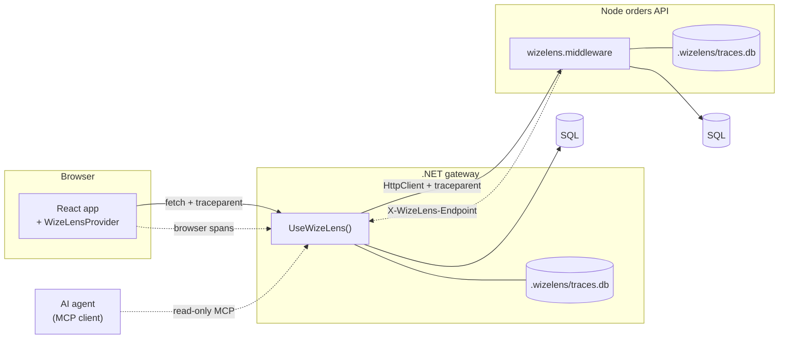

<div align="center">

<picture>
  <source media="(prefers-color-scheme: dark)" srcset="docs/images/wizelens-dark.svg">
  
</picture>

### Inspect. Understand. Build better.

See inside every request — from the React click down to the SQL query, across every service.

The spirit of **Glimpse**, rebuilt for 2026: OpenTelemetry-native, microservice-aware, and readable by AI agents (only when you allow it).

[](LICENSE)
[](https://dotnet.microsoft.com/)
[](https://nodejs.org/)
[](https://react.dev/)
[](https://opentelemetry.io/)
[](https://modelcontextprotocol.io/)


[Quick start](#quick-start) · [Getting started](docs/GETTING-STARTED.md) · [Features](#features) · [How it works](#how-it-works) · [AI access](#ai-access) · [Configuration](#configuration) · [Roadmap](#roadmap)

</div>

---

<p align="center">
  
</p>

<p align="center"><sub>One click in React → a .NET gateway → a Node API → two databases. One trace. Every N+1 problem found for you.</sub></p>

## ✨ Why WizeLens?

Glimpse showed us what a request *really* did — and then the ecosystem moved on without a replacement.
Modern apps are worse to debug, not better: a single click fans out across a front end, a gateway, a handful of services, and several data stores.

WizeLens brings back the "open the hood on this request" experience and makes it work for how we build today:

- **Drop-in.** Two lines in .NET, one middleware in Node, one provider in React.
- **End to end.** The browser, every service, and every database call land in **one** timeline.
- **Opinionated insights.** N+1 queries, N+1 HTTP calls, duplicate queries, slow queries, and errors are flagged automatically.
- **Built on open standards.** W3C `traceparent` and OpenTelemetry semantic conventions — no proprietary agent.
- **AI-ready, not AI-bundled.** No built-in AI. Agents get a read-only, redacted MCP endpoint — only if you turn it on.
- **Safe by default.** On in Development only. Secrets are redacted before anything is stored.

<a id="quick-start"></a>

## 🚀 Quick start

> **Alpha:** packages are on NuGet and npm as prereleases. Add `--prerelease` to `dotnet add package`.

```bash
dotnet add package WizeLens.AspNetCore --prerelease
npm install @wizeworks/lens-node @wizeworks/lens-react
```

### ASP.NET Core (.NET 10)

```csharp
using WizeLens;

builder.Services.AddWizeLens();   // capture, store, dashboard, API
// ...
app.UseWizeLens();                // call early in the pipeline
```

Using EF Core? Add the adapter (`WizeLens.EntityFrameworkCore`):

```csharp
using WizeLens.EntityFrameworkCore;

builder.Services.AddDbContext<AppDb>(o => o.UseSqlServer(cs).UseWizeLens());
```

Using Dapper or raw ADO.NET? Wrap the connection — every command is captured, with any provider:

```csharp
using WizeLens.Data;

await using var db = new ProfiledDbConnection(new SqlConnection(cs));
var rows = await db.QueryAsync<Order>("SELECT * FROM Orders WHERE CustomerId = @id", new { id });
```

### Node (Express)

```ts
import express from "express";
import { createWizeLens } from "@wizeworks/lens-node";

const wizelens = createWizeLens({ serviceName: "orders-api" });
const app = express();

app.use(wizelens.middleware);            // traces requests + serves /_wizelens
// ...your routes...
app.use(wizelens.errorMiddleware);       // ELMAH-style error capture

// Your database: one line, and every query is traced.
import pg from "pg";
import { instrumentPg } from "@wizeworks/lens-node";
instrumentPg(wizelens, pg);
```

Outgoing `fetch` calls and routing time are traced automatically. Not on Express? Use `wizelensFastify(wizelens)`, `wizelensKoa(wizelens)`, or `wizelensHono(wizelens)` instead of the middleware. On Next.js, call `registerWizeLens()` from `@wizeworks/lens-node/next` in `instrumentation.ts` (see [Getting started](docs/GETTING-STARTED.md#2-node)).

| Library | One line |
|---|---|
| `pg` | `instrumentPg(wizelens, pg)` |
| `mysql2` | `instrumentMysql2(wizelens, mysql)` |
| `better-sqlite3` | `instrumentBetterSqlite3(wizelens, db)` |
| `node:sqlite` | `instrumentNodeSqlite(wizelens, db)` |
| Prisma | `prisma.$extends(prismaExtension(wizelens, { system: "postgresql" }))` |
| TypeORM | `instrumentTypeOrm(wizelens, dataSource)` |
| Drizzle | `instrumentDrizzle(wizelens, db)` (on `pg`, `mysql2`, `better-sqlite3`, or `node:sqlite`) |
| Anything else | `wizelens.traceDb({ system: "postgresql" }, sql, params, () => run(sql, params))` |

An ORM and the driver under it never count the same query twice. Queries outside a request (startup, jobs) are skipped unless you set `traceQueriesOutsideRequests: true`.

### No code change

Can't touch the code? Turn WizeLens on from outside the app, set by environment variables only:

```bash
NODE_OPTIONS="--import @wizeworks/lens-node/auto" node server.js                     # Node
DOTNET_STARTUP_HOOKS=/opt/wizelens/dotnet/WizeLens.AutoInstrumentation.dll dotnet App.dll   # ASP.NET Core
```

On Kubernetes, the `wizelens-inject` Helm chart adds both to pods labeled `wizelens.dev/inject: node` or `dotnet`. The code install still wins when both are there. See [Install with no code change](site/content/docs/auto-install.md).

### React

```tsx
// main.tsx: this import must come first, before React loads.
import "@wizeworks/lens-react/install";
import { WizeLensProvider } from "@wizeworks/lens-react";

<WizeLensProvider endpoint="/_wizelens" enabled={import.meta.env.DEV}>
  <App />
</WizeLensProvider>
```

Every `fetch` gets a `traceparent` header, so each server trace links back to the click that caused it.
The `install` import lets WizeLens time React renders per component and measure hydration. Without it, everything else still works.

### Java, Python, and Go

Start from the OpenTelemetry agents; the WizeLens SDKs add SQL parameters, request bodies, logs, and sampling that keeps
errors and slow traces. They send to a hub or the cloud (`WIZELENS_HUB`).

```bash
java -javaagent:opentelemetry-javaagent.jar -Dotel.javaagent.extensions=wizelens.jar -jar app.jar   # Java
pip install wizelens && opentelemetry-instrument uvicorn app:app                                     # Python
go get github.com/brandonkorous/wizelens/go    # wizelens.Start, Handler, OpenDB, Transport, Logger  # Go
```

Guides: [Java](https://wizelens.com/docs/java/), [Python](https://wizelens.com/docs/python/), [Go](https://wizelens.com/docs/go/).
Samples: `samples/java-spring`, `samples/python-fastapi`, `samples/go-net-http`.

### Open the dashboard

Browse to **`/_wizelens`** on any service. That's it.

<a id="features"></a>

## 🔭 Features

### The in-page HUD

A small card in the corner of every page shows the latest request as you work: **Total**, **Server**, **Database**, and **Render** time, one bar that splits them, and the SQL, fetch, and insight counts.

- **One color tells you the state.** 🔵 info · 🟢 fast, no issues · 🟡 completed, but with optimizations · 🟠 slow or a 4xx · 🔴 failed · ⚪ no data.
- **Hover for a quick peek.** Database shows each query's time, the slowest, and the average. Server splits its own code, its own queries, and calls to other services.
- **Click for a closer look.** A small panel shows the split, the first rows of the timeline, the top insights, and this page's Web Vitals.
- **Everything else is one click away.** Every "view all" link and every footer count opens the full dashboard in a new tab, right on that request's timeline, SQL, HTTP calls, or insights.
- **Render time is real.** WizeLens measures from the response to the next paint: read the body, run your code, render, paint.
- **Stays out of the way.** Minimize it to the aperture mark; its center dot keeps the health color. Pin a request, or follow the newest one live. It survives page refreshes.

<p align="center"></p>

### The dashboard

Ten pages, one look. Pick a time range in the top bar; every number compares itself with the range before it.

| Page | What you get |
|---|---|
| **Overview** | Requests, duration, SQL, error rate, and insights at a glance; request activity, timing breakdown, services, recent requests, latest insights |
| **Requests** | Filter by method, status, duration, service, or text; export to CSV; a side panel with summary, headers, response, tags, and timing |
| **Traces** | One request as layers — browser, network, routing, handler, each service, each database, render — plus bottlenecks and the slowest spans |
| **Database** | Slow queries over time, time per operation, top slow queries, table hotspots |
| **Rendering** | Render time per route, SSR, hydration, image loading, layout shift, and the React components that render too often |
| **Errors** | Exceptions over time, top types, errors by service, and the stack trace and request context of each one — browser errors too |
| **Logs** | Every log line from every service, filtered by level, service, or text |
| **Metrics** | CPU, memory, GC, request times, and your own counters per service, as charts; split by any attribute |
| **Services** | Health of each service, database, and outside host, and a map of who calls whom |
| **Insights** | Every N+1, duplicate query, slow query, and render problem, ranked, with how to fix it |
| **Settings** | How each connected service is set up, and your dashboard preferences |

Open any trace for the full detail: timeline, SQL, HTTP, logs, and errors. Search everything with **Ctrl K** (**⌘ K**). Light and dark themes are built in.

<p align="center"></p>

<details>
<summary><b>More screens</b></summary>

<p align="center"></p>
<p align="center"></p>
<p align="center"></p>
<p align="center"></p>

</details>

### What gets captured

| | ASP.NET Core | Node |
|---|---|---|
| Incoming requests | ✅ hosting activity | ✅ Express, Fastify, Koa, Hono, Next.js, `node:http` |
| Outgoing HTTP | ✅ `HttpClient` | ✅ `fetch` / undici |
| Database (driver level) | ✅ `ProfiledDbConnection` — ADO.NET, Dapper, any provider | ✅ `pg`, `mysql2`, `better-sqlite3`, `node:sqlite`, and `traceDb()` for any other driver |
| Database (ORM) | ✅ EF Core | ✅ Prisma, TypeORM, Drizzle |
| Logs | ✅ `ILogger`, Serilog (`WizeLens.Serilog`), NLog (`WizeLens.NLog`) | ✅ `console`, Fastify / pino, winston, bunyan, log4js, consola, NestJS, OpenTelemetry logs, `wizelens.logger` |
| Exceptions | ✅ | ✅ |
| Metrics | ✅ every `Meter`: .NET runtime, ASP.NET Core, `HttpClient`, your own | ✅ CPU, memory, heap, event loop, GC, and OpenTelemetry metrics (`wizelensMetricExporter`) |
| Databases with no code change | ✅ Npgsql, MySqlConnector, Microsoft.Data.SqlClient | |
| gRPC | ✅ Grpc.AspNetCore, Grpc.Net.Client | ✅ `instrumentGrpc` (`@grpc/grpc-js`) |
| Message queues | ✅ RabbitMQ.Client, Azure Service Bus, MassTransit, Kafka (`WizeLens.Kafka`) | ✅ `instrumentAmqplib`, `instrumentKafkaJs`, `instrumentServiceBus` |
| Request details | ✅ headers, client IP, user, request id, body sizes, tags | ✅ same; user and tags through `setUser()` / `tag()` |
| Response bodies (opt-in) | ✅ `CaptureResponseBody` | ✅ `captureResponseBody` |
| Routing and handler time | ✅ routing and handler | ✅ routing (Express) |
| Browser | ✅ via `@wizeworks/lens-react`: fetch spans, render time, page views (TTFB, SSR, FCP, LCP, INP, CLS), hydration, slow images, React component renders, browser errors (minified stacks mapped back with source maps), browser `console` lines | |

### Persistence

Traces survive restarts (hello, `dotnet watch`). Each app keeps a small SQLite file at `.wizelens/traces.db` — the newest 2,000 traces or 24 hours, whichever comes first. If the file can't be written, WizeLens logs one warning and keeps working in memory. It never breaks your app.

### The local hub

One place for every service, also when they are stopped. Start it with `npx @wizeworks/lens-hub` (or the Docker image
`ghcr.io/brandonkorous/wizelens-hub`), then set `WIZELENS_HUB=http://localhost:5960` on each service. Apps in any other
language send OpenTelemetry (OTLP/HTTP) to the same address.

- **Everything in one dashboard**, kept for 7 days in one SQLite file, with the same pages as the in-app dashboard.
- **Projects and environments.** Set `WIZELENS_PROJECT` per service; the top bar filters by project and environment.
- **Knows your services.** See which are online, idle, or offline, what they run on, and when they last sent data.
- **Any language.** OTLP JSON or protobuf, with older attribute names mapped to current ones.
- **Safe on a team network.** Local only by default; add `--host 0.0.0.0 --token <text>` to share it.
- **One MCP endpoint** for every service with `--mcp`.

### WizeLens Cloud

The same dashboard for a whole team, with history. Run `wizelens-cloud` with Postgres (Docker image and compose file included).

- **Teams:** organizations, projects, owner, admin, member, and viewer roles, invite links, and an audit log.
- **History:** 7- and 30-day ranges, computed on the server; retention per organization.
- **Alerts:** error rate, latency, traffic, new errors, slow queries, or any metric, for everything, one service, or one
  endpoint; reminders, acknowledge, and mute; to Slack, Teams, Discord, PagerDuty, webhooks, and email. On the hub and the cloud.
- **Sharing:** read-only links to a single trace that expire.
- **Safe AI access:** read keys limited to chosen projects; every MCP call is logged.

<a id="how-it-works"></a>

## 🧭 How it works



1. **Capture.** Each service records OpenTelemetry-shaped spans: requests, HTTP calls, database calls, logs, and exceptions.
2. **Link.** The W3C `traceparent` header carries one trace id from the browser through every hop.
3. **Discover.** Each response says where its WizeLens lives (`X-WizeLens-Endpoint`), so callers learn about downstream services automatically.
4. **Federate.** When you open a trace, the service you're looking at pulls the matching pieces from every downstream service and merges them into one timeline. No collector to run.
5. **Analyze.** The same rules run in .NET and JS, so the insights match no matter which service you open.

The full wire format — headers, endpoints, types, storage schema, and analysis rules — is in **[docs/CONTRACT.md](docs/CONTRACT.md)**. Any language can implement it.

<a id="ai-access"></a>

## 🤖 AI access (MCP)

WizeLens has no AI of its own. Instead, your AI tools can *read* what WizeLens sees — with your permission.

Turn it on per service:

```csharp
builder.Services.AddWizeLens(o => o.EnableMcp = true);
```

```ts
createWizeLens({ serviceName: "orders-api", enableMcp: true });
```

Then point any MCP client at the streamable HTTP endpoint:

```json
{
  "mcpServers": {
    "wizelens-gateway": { "type": "http", "url": "http://localhost:5100/_wizelens/mcp" }
  }
}
```

| Tool | What it answers |
|---|---|
| `list_traces` | "What happened recently? Anything slow or failing?" |
| `get_trace` | "Show me everything that happened in this request, across services." |
| `find_slow_queries` | "Which queries are slow?" |
| `find_n_plus_one` | "Where are my N+1 queries and N+1 HTTP calls?" |
| `get_errors` | "What broke, and where?" |

Guardrails:

- **Off by default**, and only available when WizeLens itself is enabled.
- **Read-only.** No tool can change anything.
- **Redacted.** Values for keys like `authorization`, `cookie`, `password`, `token`, `secret`, and `connectionstring` are replaced with `[redacted]` before they are stored — so an agent never sees them.
- **Audited.** Every tool call writes an audit line to the app log.

<a id="configuration"></a>

## ⚙️ Configuration

### .NET — `AddWizeLens(o => { ... })`

| Option | Default | Description |
|---|---|---|
| `Enabled` | `WIZELENS_ENABLED`, else Development only | Turn WizeLens on or off. |
| `Dashboard` | `WIZELENS_DASHBOARD`, else Development only | Serve the dashboard, read API, and MCP. `false` is send-only: capture and send to the hub or cloud, no reads. |
| `BasePath` | `/_wizelens` | Where the dashboard and API live. |
| `ServiceName` | app name | Name shown for this service. |
| `Storage` | `Sqlite`, or `Memory` when send-only | `Sqlite` (survives restarts) or `Memory`. |
| `StoragePath` | `.wizelens/traces.db` | SQLite file, relative to the content root. |
| `MaxTraces` | `2000` | Traces kept in memory and on disk. |
| `MaxAge` | `24h` | Traces older than this are dropped. |
| `EnableMcp` | `false` | Expose the read-only MCP endpoint at `{BasePath}/mcp`. |
| `RedactKeys` | see above | Key fragments whose values are redacted. |
| `NPlusOneThreshold` | `5` | Repeats in one trace that count as N+1. |
| `SlowQueryMs` | `100` | Queries at or above this are slow. |
| `CaptureResponseBody` | `false` | Keep the first 16 KB of text and JSON responses. |
| `HubUrl` / `HubToken` | `WIZELENS_HUB` / `WIZELENS_HUB_TOKEN` | Also send everything to a local hub. |
| `Project` | `WIZELENS_PROJECT` | Groups this service with others on a shared hub. |
| `Sampling.Rate` | `WIZELENS_SAMPLE_RATE`, else `1` | Share of traces kept (0 to 1). Traces with an error or a slow span are kept at any rate. |
| `Logs.Outside` / `Logs.MinLevel` / `Logs.SampleRate` | `true` / `Information` / `1` (or `WIZELENS_LOGS_OUTSIDE`, `WIZELENS_LOGS_MIN_LEVEL`, `WIZELENS_LOGS_SAMPLE_RATE`) | Log lines written outside a request (startup, jobs, timers): on or off, the lowest level, and the share below `Warning` kept. |
| `Sampling.KeepErrors` / `Sampling.KeepSlowMs` | `true` / `1000` | What a sampled-out trace needs to be kept anyway (`null` turns the slow rule off). |

Tag a request from anywhere in it: `WizeLensRequest.Tag("cache", "hit")`. The user comes from `HttpContext.User`.

### Node — `createWizeLens({ ... })`

| Option | Default | Description |
|---|---|---|
| `serviceName` | *(required)* | Name shown for this service. |
| `enabled` | `WIZELENS_ENABLED`, else on unless `NODE_ENV=production` | Turn WizeLens on or off. |
| `dashboard` | `WIZELENS_DASHBOARD`, else on unless `NODE_ENV=production` | Serve the dashboard, read API, and MCP. `false` is send-only: capture and send to the hub or cloud, no reads. |
| `basePath` | `/_wizelens` | Where the dashboard and API live. |
| `storage` | `"sqlite"`, or `"memory"` when send-only | `"sqlite"` or `"memory"`. |
| `storagePath` | `{cwd}/.wizelens/traces.db` | SQLite file. |
| `maxTraces` / `maxAgeMs` | `2000` / 24 h | Retention. |
| `enableMcp` | `false` | Expose the read-only MCP endpoint. |
| `redactKeys` | see above | Key fragments whose values are redacted. |
| `instrumentFetch` | `true` | Trace outgoing `fetch` / undici calls. |
| `traceQueriesOutsideRequests` | `false` | Database adapters also trace queries outside a request. |
| `publicEndpoint` | auto | Override `X-WizeLens-Endpoint` (useful behind proxies). |
| `audit` | `console.info` | Where MCP audit lines go. |
| `slowQueryMs` / `nPlusOneThreshold` | `100` / `5` | Analysis thresholds. |
| `captureResponseBody` | `false` | Keep the first 16 KB of text and JSON responses. |
| `hub` / `hubToken` | `WIZELENS_HUB` / `WIZELENS_HUB_TOKEN` | Also send everything to a local hub. |
| `project` | `WIZELENS_PROJECT` | Groups this service with others on a shared hub. |
| `sampling` | `{ rate: WIZELENS_SAMPLE_RATE ?? 1, keepErrors: true, keepSlowMs: 1000 }` | Keep a share of traces, plus every trace with an error or a slow server-side span. |
| `logs` | `{ outside: true, minLevel: "info", sampleRate: 1 }` (or the `WIZELENS_LOGS_*` variables) | Log lines written outside a request: on or off, the lowest level, and the share below `"warn"` kept. |

Next.js: `registerWizeLens(options)` takes the same options plus `ignore(path)`, and `onRequestError` records server errors.

Tag a request and name its user from your handlers: `wizelens.tag("cache", "hit")`, `wizelens.setUser(id)`.

### React — `<WizeLensProvider>`

| Prop | Default | Description |
|---|---|---|
| `endpoint` | `/_wizelens` | WizeLens base path or URL on your API. |
| `enabled` | `true` | Pass `import.meta.env.DEV` (or similar). |
| `hud` | `true` | Show the in-page HUD. `false` also stops reading traces back, for a send-only server. |
| `propagateTo` | same origin | Which requests get a `traceparent` header. |
| `slowMs` | `500` | The HUD shows requests at or over this many ms as "warning" (orange). |
| `capturePages` | `true` | Send page views, React render stats, and browser errors. |

Hooks: `useWizeLens()` and `useWizeLensRequests()`.

## 🧪 Run the sample

A React shop → a .NET gateway (EF Core + SQLite) → a Node orders API (`node:sqlite`). The gateway has a deliberate N+1 so you have something to find.

**Needs:** .NET 10 SDK, Node 22.13+ (24 recommended), pnpm 10.

```bash
pnpm install
pnpm build                                   # JS packages + the dashboard UI
dotnet run --project samples/gateway-api     # http://localhost:5100
pnpm dev:orders                              # http://localhost:5200
pnpm dev:web                                 # http://localhost:5173
```

Open http://localhost:5173, click the buttons, then open http://localhost:5173/_wizelens/.

To try the hub, start it first with `pnpm dev:hub` (http://localhost:5960/_wizelens/), then start the other three with
`WIZELENS_HUB=http://localhost:5960` set.

> The .NET add-on embeds the dashboard at build time. After `pnpm build`, rebuild the .NET app to pick up UI changes.

## 📦 Packages

| Package | Platform | What it is |
|---|---|---|
| `WizeLens.AspNetCore` | NuGet | The ASP.NET Core add-on |
| `WizeLens.EntityFrameworkCore` | NuGet | EF Core adapter |
| `WizeLens.AutoInstrumentation` | NuGet, zip | Startup hook: WizeLens with no code change |
| `wizelens-inject` | Docker, Helm | Kubernetes webhook that adds the hooks to labeled pods |
| `@wizeworks/lens-node` | npm | The Node add-on |
| `@wizeworks/lens-react` | npm | Browser tracing + HUD |
| `@wizeworks/lens-core` | npm | Shared types, trace context, analysis |
| `@wizeworks/lens-ui` | npm | The dashboard (served by both add-ons and the hub) |
| `@wizeworks/lens-hub` | npm, Docker | The local hub (`wizelens-hub`) |
| `@wizeworks/lens-cloud` | npm, Docker | The cloud service (`wizelens-cloud`) |
| `@wizeworks/lens-cli` | npm | Source map upload (`lens-cli`) and Vite, webpack, and Next.js plugins |
| `com.wizelens:wizelens` | Maven | Java: the OpenTelemetry agent extension and a servlet body filter (`java/`) |
| `wizelens` | PyPI | Python: distro for `opentelemetry-instrument`, body middleware, SQL parameters (`python/`) |
| `github.com/brandonkorous/wizelens/go` | Go module | Go: SDK setup, `net/http`, `database/sql`, `slog` (`go/`) |

<a id="roadmap"></a>

## 🗺️ Roadmap

| Phase | Shape | Status |
|---|---|---|
| **1. In-app add-on** | A package inside each app, with local SQLite and federation across services | ✅ Complete (alpha) |
| **2. Local hub** | One small service on your machine or network; every app sends to it | ✅ Complete (alpha) |
| **3. Cloud** | Hosted, team-wide history, alerts, and sharing | ✅ Complete (alpha) |

All three phases are complete. The cloud (accounts, teams, server-side stats, alerts, sharing, scoped AI access) ships in 0.3.0-alpha.1. See the [changelog](CHANGELOG.md).
New to WizeLens? Start with the **[getting-started guide](docs/GETTING-STARTED.md)**.

See **[docs/PLAN.md](docs/PLAN.md)** for the full plan.

## 🛠️ Development

```text
docs/                 PLAN.md, CONTRACT.md, images
dotnet/               WizeLens.slnx — src/ (add-ons), tests/
js/packages/          core · node · react · ui
samples/              web (React) · gateway-api (.NET) · orders-api (Node) · next-web (Next.js)
site/                 the marketing site (Next.js static export: pnpm dev:site, pnpm build:site → site/out)
```

```bash
pnpm build && pnpm test                      # JS: build + tests
pnpm check:size                              # size rules, JS and .NET
dotnet build dotnet/WizeLens.slnx            # .NET: build
dotnet test  dotnet/WizeLens.slnx            # .NET: tests
```

Code rules, checked by `pnpm check:size`: at most 250 lines per file, 50 lines per function, and one line per comment. Every CSS class and variable starts with `wl-`.

Changing the wire format? Update **[docs/CONTRACT.md](docs/CONTRACT.md)** first — both add-ons and the dashboard follow it.

## 🙏 Inspired by

[Glimpse](https://github.com/Glimpse/Glimpse) — the original "see inside the request" tool for ASP.NET.
[MiniProfiler](https://miniprofiler.com/) — fast, focused timing.
[ELMAH](https://elmah.github.io/) — error logging done right.

WizeLens is an independent project and is not affiliated with any of them.

## 📄 License

The add-ons are [MIT licensed](LICENSE). © 2026 WizeWorks LLC.
